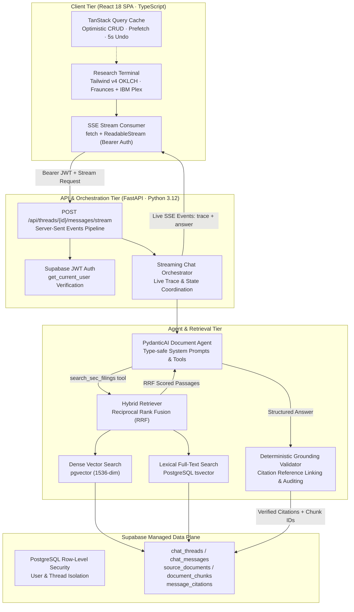

# Document Copilot (DCopilot)

> **Institutional SEC 10-K Financial Research Platform with Guaranteed Grounding & Verifiable Citations**

[](https://feisty-vitality-production-0f8b.up.railway.app/)
[](https://fastapi.tiangolo.com)
[](https://react.dev)
[](https://tailwindcss.com)
[](https://supabase.com)
[](https://openai.com)
[]()
[]()

---

### 🌐 Live Production Deployment

**Access the live application:** [https://feisty-vitality-production-0f8b.up.railway.app](https://feisty-vitality-production-0f8b.up.railway.app)

* Deployed from branch `product-ui` on **Railway**.
* Single-Page Application (SPA) served via an optimized **Nginx Alpine** container with 1-year immutable asset caching and dynamic `$PORT` binding.
* Backed by a high-throughput **FastAPI** service, **PydanticAI** agent workflows, and a **Supabase PostgreSQL** data plane with `pgvector` and Row-Level Security (RLS).

---

## Quick Links

- [Architecture Overview](#system-architecture)
- [Signature Features](#signature-features)
- [Live Agent Activity Trace](#live-agent-activity-trace)
- [SEC 10-K Filings Coverage](#sec-10-k-filings-coverage)
- [Sample Queries to Try](#sample-analyst-queries-to-try-live)
- [Tech Stack & Engineering Decisions](#tech-stack--engineering-decisions)
- [Local Development Setup](#local-development-setup)
- [Automated Test Suite](#automated-test-suite--verification)

---

## Overview

Financial analysts spend 40+ hours every quarterly reporting cycle manually parsing 100+ page SEC 10-K filings to extract segment revenue, margins, capital expenditure disclosures, and risk factors. Traditional LLM-based chat interfaces frequently hallucinate metrics, cross-contaminate fiscal years, or fail on verbatim financial verification.

**Document Copilot (DCopilot)** solves this with a **deterministic grounding pipeline**:
1. **Hybrid Retrieval:** Fuses dense vector embeddings (`pgvector` cosine similarity) and PostgreSQL lexical search (`tsvector`) via **Reciprocal Rank Fusion (RRF)**.
2. **Real-Time Agent Trace:** Streams live agent execution steps over **Server-Sent Events (SSE)** with millisecond elapsed timing.
3. **Deterministic Grounding Validator:** Parses inline `[N]` citation badges, validates each claim against verbatim SEC source passages, attaches exact chunk UUIDs, and links directly to official SEC EDGAR accession URLs. If evidence is absent or a company is outside the corpus, the agent refuses rather than guessing.

---

## System Architecture



---

## Signature Features

### 1. Guaranteed Grounding & Verifiable Citations
- **Inline Badges:** Every numerical assertion is tagged with an inline citation badge `[N]` (e.g. `[1]`, `[2]`).
- **Portal-Rendered Tooltip:** Hovering or focusing a badge displays an edge-clamped tooltip with the filing ticker, fiscal year, and section.
- **Verbatim SEC Excerpt Drawer:** Clicking any badge opens an accessible slide-over drawer displaying the verbatim text passage, CIK, filing date, RRF score, and a direct hyperlink to the official SEC EDGAR filing.
- **Anti-Hallucination Guardrails:** If requested metrics are not present in the SEC filing or if an analyst inquires about an out-of-corpus company, the agent explicitly refuses.

### 2. Live Agent Activity Trace
- Transparent, real-time feedback during generation powered by native **Server-Sent Events (SSE)**.
- Step-by-step progress:
  - `Searching filings` *(query & ticker filters)*
  - `Found N passages` *(retrieved chunk metadata)*
  - `Merging results` *(RRF ranking)*
  - `Writing answer` *(structured generation)*
  - `Verifying citations` *(grounding validation)*
- Displays precise millisecond timings (`elapsed_ms`) and collapses upon completion into a clean summary badge: `Researched in 2.3s · 4 sources`.

### 3. Institutional Research Terminal
- **Dynamic Thread Management:** Filter research threads with instantaneous debounced search, date grouping (*Today*, *Yesterday*, *Previous 7 Days*, *Older*), and optimistic deletion with a 5-second Undo toast.
- **Executive Export:** One-click export of complete research threads to **Markdown** complete with citations, metadata, and verbatim source passages for investment memos.
- **Copy Utilities:** Copy pure response text or response with cited footnotes directly to clipboard.
- **Keyboard Shortcuts:** `⌘K` / `Ctrl+K` for instant new thread, `/` to focus query input, `Esc` to dismiss drawers and dialogs.

### 4. Impeccable Design System
- **Typography:** Self-hosted **Fraunces** display serif for headlines, **IBM Plex Sans** for clean body readability, and **IBM Plex Mono** for financial numbers and tickers (`tabular-nums`).
- **Color Architecture:** Tailored OKLCH palette using tinted slate neutrals and an institutional emerald accent (`oklch(0.69 0.17 155)`).
- **Dark-First Theme:** Dark mode default with persistent light mode toggle (`localStorage`).
- **Responsive & Accessible:** Fluid layout (320px–1920px), touch targets ≥44px, inputs ≥16px to prevent iOS auto-zoom, zero horizontal scroll, WCAG AA contrast, and `prefers-reduced-motion` compliance.

---

## SEC 10-K Filings Coverage

The indexed corpus contains complete, audited Annual 10-K filings with primary coverage across core operational and financial disclosures:

| Ticker | Company Name | CIK | Fiscal Year | Parsed Filing Sections |
| :--- | :--- | :--- | :--- | :--- |
| **AAPL** | Apple Inc. | `0000320193` | FY2025 | Item 1 (Business), Item 1A (Risk Factors), Item 7 (MD&A), Item 7A, Item 8 (Financial Statements) |
| **MSFT** | Microsoft Corporation | `0000789019` | FY2024 | Item 1 (Business), Item 1A (Risk Factors), Item 7 (MD&A), Item 7A, Item 8 (Financial Statements) |
| **NVDA** | NVIDIA Corporation | `0001045810` | FY2025 | Item 1 (Business), Item 1A (Risk Factors), Item 7 (MD&A), Item 7A, Item 8 (Financial Statements) |
| **AMZN** | Amazon.com, Inc. | `0001018724` | FY2024 | Item 1 (Business), Item 1A (Risk Factors), Item 7 (MD&A), Item 7A, Item 8 (Financial Statements) |
| **GOOGL** | Alphabet Inc. | `0001652044` | FY2024 | Item 1 (Business), Item 1A (Risk Factors), Item 7 (MD&A), Item 7A, Item 8 (Financial Statements) |

---

## Sample Analyst Queries to Try Live

You can test the grounding and citation precision on the [Live Demo](https://feisty-vitality-production-0f8b.up.railway.app):

1. **Segment Revenue & Margin Analysis:**
   > *"What were Apple's Services segment net sales in fiscal 2025, and what was the Services gross margin?"*
2. **Cloud Infrastructure Comparison:**
   > *"Compare Microsoft Intelligent Cloud revenue in FY2024 with Alphabet's Google Cloud revenue growth."*
3. **Risk Factor Disclosures (Item 1A):**
   > *"What did NVIDIA disclose regarding geopolitical risks and US export controls on advanced AI chips in Item 1A?"*
4. **Capital Expenditure & AI Infrastructure:**
   > *"What did Amazon report regarding AWS capital expenditures and cash spent on technology infrastructure in FY2024?"*
5. **Anti-Hallucination & Out-of-Corpus Refusal:**
   > *"What was Tesla's (TSLA) automotive gross margin in fiscal 2024?"* *(Watch the agent properly refuse because TSLA is not in the indexed corpus).*

---

## Tech Stack & Engineering Decisions

| Layer | Technology | Decision Rationale |
| :--- | :--- | :--- |
| **Backend Service** | **Python 3.12 + FastAPI** | Native async concurrency, Pydantic v2 data validation, lightweight ASGI streaming. |
| **Package Management** | **Astral `uv`** | Sub-second deterministic dependency resolution via `uv.lock`. |
| **Agent Orchestration** | **PydanticAI** | Type-safe structured output generation with explicit dependency injection. |
| **Database & Vector Store** | **Supabase Postgres + `pgvector`** | Unified relational data, JSONB storage, full-text `tsvector`, and 1536-dimension vector indexing. |
| **Migrations** | **Alembic + SQLAlchemy 2.0** | Version-controlled database schema migrations for tables, indexes, and vector types. |
| **Security & Auth** | **Supabase Auth (JWT Bearer)** | Secure stateless token verification with PostgreSQL Row-Level Security (RLS) enforcement. |
| **Frontend Framework** | **Vite + React 18 + TypeScript** | Strict typing (`tsc -b`), fast HMR, and ultra-lean production bundle footprint. |
| **Client State & Cache** | **TanStack Query v5** | Server state synchronization, optimistic CRUD mutations, request deduplication, and prefetch. |
| **Design Tokens** | **Tailwind CSS v4** | Modern `@theme` CSS tokens in OKLCH space; zero runtime JavaScript overhead. |
| **Production Serving** | **Docker + Nginx Alpine** | Gzip compression, 1-year immutable `/assets/*` caching, strict `index.html` no-cache, dynamic Railway `$PORT` substitution. |

---

## Local Development Setup

### 1. Prerequisites

- **Python 3.12+**
- **Astral `uv`** (`curl -LsSf https://astral.sh/uv/install.sh | sh`)
- **Node.js 20+ (LTS)** & **pnpm** (`corepack enable && corepack prepare pnpm@latest --activate`)
- **Docker** (optional, for verifying container builds locally)

---

### 2. Backend Service Setup

```bash
cd backend

# 1. Install dependencies from lockfile
uv sync

# 2. Configure environment variables
# Copy .env.example to .env and configure SUPABASE and OPENAI keys
cp .env.example .env

# 3. Run database migrations
uv run alembic upgrade head

# 4. Execute test suite (48 tests)
uv run pytest

# 5. Start development API server
uv run uvicorn app.main:app --port 8000 --reload
```

---

### 3. Frontend Client Setup

```bash
cd frontend

# 1. Install dependencies
pnpm install

# 2. Typecheck and verify build
pnpm build

# 3. Start local development server
pnpm dev
```

The application will be running at `http://localhost:5173`.

---

### 4. Production Container Build & Verification

```bash
cd frontend

# Build the production Docker image
docker build -t dcopilot-frontend .

# Run container locally with dynamic PORT simulation
docker run -d -p 8080:80 -e PORT=80 dcopilot-frontend

# Verify caching headers:
curl -I http://localhost:8080/index.html   # Cache-Control: no-cache, no-store, must-revalidate
curl -I http://localhost:8080/app          # 200 OK (Nginx SPA fallback)
```

---

## Automated Test Suite & Verification

The project enforces strict automated verification across both backend and frontend layers:

- **Backend Pytest Suite (48/48 Passing):**
  - Dense vector and lexical BM25 retrieval tests.
  - Reciprocal Rank Fusion (RRF) scoring logic.
  - Grounding validator citation bounds and refusal rules.
  - Supabase JWT 401 unauthorized handling and RLS thread scoping.
  - SSE streaming endpoint event delivery, order validation, and error recovery.
- **Frontend Quality Gates:**
  - TypeScript strict mode (`tsc -b`) passing with **zero `any` types**.
  - Production client bundle: **~31.9 kB gzip** initial application chunk.
  - Separate lazy chunk for public static landing page: **~6.5 kB gzip**.
  - WCAG AA color contrast verified across both dark and light modes.
  - Tested across mobile (320px, 375px), tablet (768px), and desktop (1024px, 1440px, 1920px) viewports.

---

## License & Compliance

Demo project engineered for institutional SEC filing research and investment memo preparation. Data sourced directly from public SEC EDGAR filings. This software is provided for research and informational purposes and does not constitute financial or investment advice.
